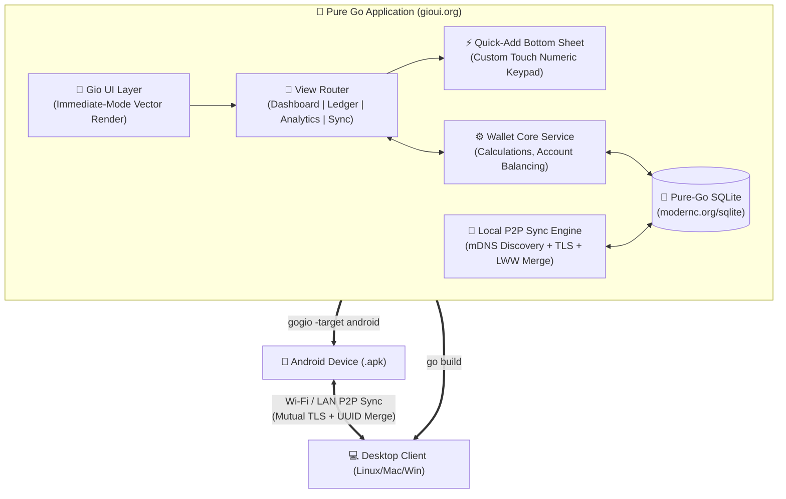
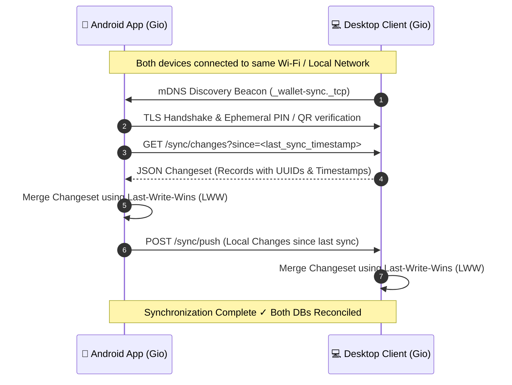

# Native Android App with Pure Go & Gio UI (`gogio`) — Plan

> **Branch:** `native-android-go`  
> **Architecture:** 100% Pure Go Mobile & Desktop Application  
> **UI Engine:** Gio UI (`gioui.org`) compiled via `gogio`  
> **Database:** Pure-Go SQLite (`modernc.org/sqlite` — zero CGO)  
> **Sync Engine:** Local Network Peer-to-Peer (mDNS + TLS + Last-Write-Wins UUIDs)

---

## 1. Executive Summary & Strategy

We will build the native Android Wallet app as a **100% pure Go application** using **Gio UI (`gioui.org`)** compiled directly to an Android APK via **`gogio`**.

### Why Gio UI & `gogio` for this Project?
1. **Zero Gradle / Zero Java / Zero Kotlin**:
   - The entire application is written in Go.
   - `gogio` directly outputs a release-ready `.apk` or `.aab` for Android (`arm64-v8a`, `armeabi-v7a`, `x86_64`) without needing Android Studio or Gradle wrappers.
2. **True Cross-Platform (Mobile & Desktop Shared 100%)**:
   - The exact same Go code runs on **Android** (`gogio -target android`) and on **Desktop** (Linux, macOS, Windows via `go run .`).
   - This makes local network sync seamless because both your phone and desktop run the identical Go SQLite engine, models, and sync protocols.
3. **Hardware-Accelerated Fluid Performance**:
   - Gio compiles down to raw Vulkan / OpenGL ES 2.0+ on Android with its own retained vector rendering pipeline.
   - High refresh-rate touch interactions (90Hz / 120Hz displays).
   - Cold-start launch time under **100ms** on mobile devices.
4. **Lightweight Distribution**:
   - Final Android APK size is only **~12 – 15 MB**.

---

## 2. System Architecture



---

## 3. UI/UX Blueprint for Android (Gio UI Immediate-Mode)

Gio UI uses an immediate-mode paradigm (`layout.Context`, `op.Ops`), granting complete pixel-level control over animations, touch targets, and layouts.

### A. Color Palette & Visual Tokens (OLED Dark Theme)
- **Background**: `#090A0F` (True OLED Black)
- **Surface**: `#12141C`
- **Surface Elevated**: `#1A1D29`
- **Border / Separators**: `#262A3B`
- **Income Accent**: `#10B981` (Emerald Green)
- **Expense Accent**: `#F43F5E` (Rose / Crimson)
- **Primary Brand / Action**: `#3B82F6` (Electric Blue)

### B. Screen Structure & Components
```
┌──────────────────────────────────────────────┐
│  WALLET ৳                       [🔄 LAN Sync]│ <- Top Bar (Title + Sync beacon status)
├──────────────────────────────────────────────┤
│  ┌────────────────────────────────────────┐  │
│  │ <          OCTOBER 2026          >     │  │ <- Month Carousel
│  │                                        │  │
│  │ Net Balance:    ৳18,221.00            │  │ <- Hero Balance Card
│  │ 🟢 In: ৳31,200.00    🔴 Out: ৳12,979.00│  │
│  │ -------------------------------------- │  │
│  │ Account: ৳18,221.00 | Cash: ৳0.00      │  │ <- Account reconciliation split
│  │ Status: Balanced ✓                     │  │ <- "Need Balancing" sanity check
│  └────────────────────────────────────────┘  │
│                                              │
│  Recent Transactions:                        │
│  ┌────────────────────────────────────────┐  │
│  │ 20 Oct  Groceries         -৳1,500.00   │  │
│  │ 18 Oct  Home Internet       -৳650.00   │  │ <- Virtualized Gio List
│  │ 15 Oct  Salary           +৳25,000.00   │  │    (layout.List with smooth fling)
│  └────────────────────────────────────────┘  │
│                                              │
├──────────────────────────────────────────────┤
│   [🏠 Home]    [📋 Ledger]    [📊 Insights]  │ <- Bottom Thumb Nav
│                     ( ➕ )                    │ <- Elevated Center Add Action
└──────────────────────────────────────────────┘
```

### C. Tactile Quick-Add Modal & Custom Numeric Keypad
Tapping **( ➕ )** renders an immediate-mode overlay sheet:
1. **Segmented Toggle**: `[Expense]` vs `[Income]`.
2. **Large Live Display**: Amount formatted in bold BDT (`৳ 4,500.00`).
3. **Custom On-Screen Numeric Keypad**:
   - `[ 1 ] [ 2 ] [ 3 ]`
   - `[ 4 ] [ 5 ] [ 6 ]`
   - `[ 7 ] [ 8 ] [ 9 ]`
   - `[ . ] [ 0 ] [ ⌫ ]`
   - *Why on-screen?* Avoids Android software keyboard resize lag, ensuring instant 1-thumb entry.
4. **Quick Category Pills**: Horizontal scroll row of chips (`Food`, `Rent`, `Wifi`, `Electricity`, `Transport`, etc.).
5. **Account Selector**: One-tap toggle between `[Account (Bank/MFS)]` and `[Cash]`.
6. **Date Controls**: Defaults to Today with quick buttons `[Today]` and `[Yesterday]`.

---

## 4. Pure-Go Database Engine (`modernc.org/sqlite`)

We will use **`modernc.org/sqlite`**, a pure-Go transpilation of SQLite that **does not require CGO**. This allows cross-compiling for Android targets from any host with zero NDK toolchain friction.

### Sync-Ready Schema
```sql
CREATE TABLE IF NOT EXISTS transactions (
    id TEXT PRIMARY KEY,               -- UUID v4
    date TEXT NOT NULL,                -- YYYY-MM-DD
    type TEXT NOT NULL,                -- 'income' | 'expense'
    benf TEXT NOT NULL,                -- Beneficiary / Payee / Source
    exp_cat TEXT NOT NULL,             -- Category
    amount REAL NOT NULL,              -- BDT (৳)
    account TEXT NOT NULL,             -- 'Account' | 'Cash'
    notes TEXT,                        -- Optional remarks
    created_at INTEGER NOT NULL,       -- Unix timestamp (ms)
    updated_at INTEGER NOT NULL,       -- Unix timestamp (ms)
    deleted_at INTEGER DEFAULT NULL,   -- Tombstone for soft deletes (ms)
    device_id TEXT NOT NULL,           -- Device UUID
    version INTEGER DEFAULT 1 NOT NULL -- Monotonic version counter
);

CREATE INDEX IF NOT EXISTS idx_tx_date ON transactions(date);
CREATE INDEX IF NOT EXISTS idx_tx_cat ON transactions(exp_cat);
CREATE INDEX IF NOT EXISTS idx_tx_updated ON transactions(updated_at);
CREATE INDEX IF NOT EXISTS idx_tx_deleted ON transactions(deleted_at);

CREATE TABLE IF NOT EXISTS meta (
    key TEXT PRIMARY KEY,
    value TEXT NOT NULL
);
```

---

## 5. Peer-to-Peer Local Network Sync Architecture

Because the app is 100% Go, the sync engine is built using Go's standard library `net/http` and `crypto/tls`.



### Conflict Resolution Rules:
1. **New Record (Unknown UUID)** $\rightarrow$ Insert locally.
2. **Existing Record (UUID matches)**:
   - If `remote.updated_at > local.updated_at` $\rightarrow$ Overwrite local fields.
   - If `local.updated_at >= remote.updated_at` $\rightarrow$ Retain local version.
3. **Deletions (Tombstones)**:
   - If `deleted_at` is set and newer than local update $\rightarrow$ Mark soft-deleted locally. Prevents deleted records from resurrecting across devices.

---

## 6. Repository Layout (for `native-android-go`)

```
wallet/
├── cmd/
│   └── wallet/
│       └── main.go                  # Main entrypoint & Gio event loop
│
├── ui/                              # Gio UI Subsystem
│   ├── app.go                       # Top-level window coordinator & state
│   ├── theme.go                     # OLED dark theme & typography tokens
│   ├── icon/                        # Custom vector icons (Home, Add, Sync)
│   └── components/
│       ├── header.go                # Top bar with sync indicator
│       ├── month_selector.go        # Month carousel (< October 2026 >)
│       ├── hero_card.go             # Net balance & account reconciliation
│       ├── tx_list.go               # Virtualized smooth touch list
│       ├── quick_add_sheet.go       # Bottom sheet transaction modal
│       ├── keypad.go                # Custom on-screen numeric keypad
│       ├── analytics_view.go        # Spending breakdown bars
│       └── sync_view.go             # LAN pairing & sync controls
│
├── core/                            # Core Business Logic & Models
│   ├── models.go                    # Transaction, AccountSummary, SyncPackage
│   └── service.go                   # Calculations, balancing checks
│
├── db/                              # Database Engine
│   ├── sqlite.go                    # modernc.org/sqlite database connection
│   └── repository.go                # CRUD queries, indexes, migrations
│
├── sync/                            # P2P Local Network Sync
│   ├── discovery.go                 # mDNS / LAN discovery beacon
│   ├── server.go                    # Embedded HTTPS sync server
│   ├── client.go                    # Remote peer client
│   └── merger.go                    # LWW conflict resolution
│
├── scripts/
│   ├── build-android.sh             # gogio build automation
│   ├── run-desktop.sh               # go run . (instant desktop test)
│   └── install-phone.sh             # adb install helper
│
├── go.mod                           # Go dependencies (gioui.org, modernc.org/sqlite)
├── go.sum
└── ANDROID_GO_PLAN.md               # This planning document
```

---

## 7. Build & Tooling Setup

### Prerequisites
- Go 1.22+ (installed: `go1.27.2`)
- Android SDK (or Command Line Tools) with `platform-tools` (`adb`)
- `gogio` CLI tool:
  ```bash
  go install gioui.org/cmd/gogio@latest
  ```

### Build Commands
1. **Run Instantly on Desktop** (for rapid development):
   ```bash
   go run ./cmd/wallet
   ```
2. **Build Android APK**:
   ```bash
   gogio -target android -arch arm64 -appid com.shakilnwz.wallet -o wallet.apk ./cmd/wallet
   ```
3. **Install on Phone via ADB**:
   ```bash
   adb install -r wallet.apk
   ```

---

## 8. Implementation Milestones

- [ ] **Milestone 1: Project Initialization & Go SQLite Layer**
  - Initialize `go.mod` with `gioui.org` and `modernc.org/sqlite`.
  - Implement SQLite migrations, CRUD methods, and account balancing math in `db/`.
  - Write Go unit tests (`go test ./...`).

- [ ] **Milestone 2: Gio UI Foundation & Window Loop**
  - Set up `cmd/wallet/main.go` and Gio window event loop.
  - Define OLED dark theme tokens (`ui/theme.go`).
  - Implement responsive mobile frame container (`100% width, touch scrolling`).

- [ ] **Milestone 3: Mobile Dashboard & Custom Keypad**
  - Implement Top Header, Month Carousel, and Hero Balance Card.
  - Build the touch-optimized numeric keypad (`ui/components/keypad.go`).
  - Build the Quick-Add Bottom Sheet with category chips and payment toggles.
  - Build the virtualized transaction ledger list (`ui/components/tx_list.go`).

- [ ] **Milestone 4: Android Build Automation via `gogio`**
  - Write `scripts/build-android.sh` to package APKs for `arm64-v8a`.
  - Verify touch responsiveness, keypad animations, and SQLite persistence on Android device.

- [ ] **Milestone 5: P2P Local Network Sync Engine**
  - Implement mDNS LAN beacon advertiser and scanner (`sync/discovery.go`).
  - Implement HTTPS sync endpoints with QR code / PIN verification.
  - Implement incremental changeset exchange and Last-Write-Wins merging.
  - Test synchronization between Android phone and Desktop app.
