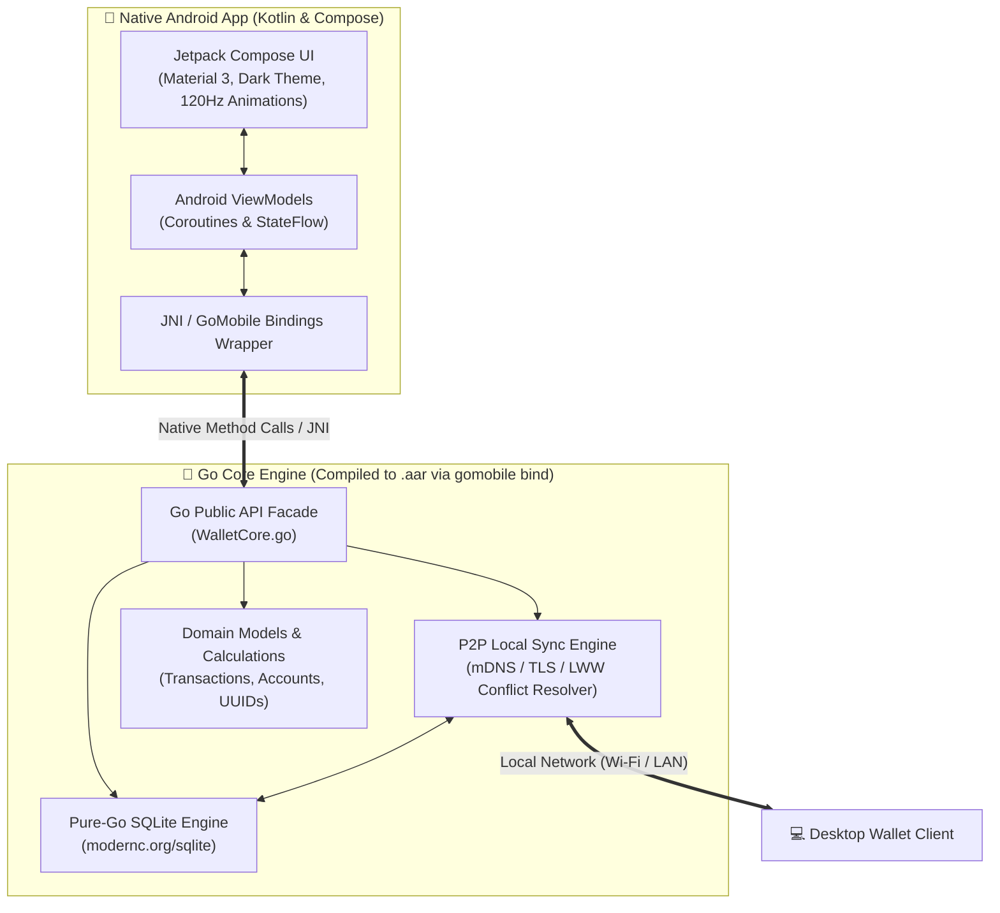

# Native Android App with Go (Wallet) — Architectural & Implementation Plan

> **Branch:** `native-android-go`  
> **Target:** Native Android personal expense & income tracker powered by Go, with local SQLite storage and peer-to-peer local network sync.

---

## 1. Executive Summary & Technology Selection

The goal is to build a high-performance native Android application where the core business logic, SQLite database operations, and local network cross-device sync are driven by **Go**, while taking full advantage of native Android phone hardware, display, and ergonomics.

### Architectural Approaches Comparison

| Architecture | UI Layer | Core Engine | Pros | Trade-offs | Recommendation |
| :--- | :--- | :--- | :--- | :--- | :--- |
| **Option A: Hybrid Native (Compose + Go)** | **Jetpack Compose** (Kotlin) | **Go Core** via `gomobile bind` (`.aar`) | • 100% native Android Material 3 look & feel<br>• 120Hz gesture physics and animations<br>• Native system widgets & quick settings<br>• Go handles SQLite & networking concurrently | • Requires two toolchains (Gradle + Go) | ⭐ **Recommended (Best UX & Stability)** |
| **Option B: Pure Go (Gio UI)** | **Gio UI** (`gioui.org`) | **Go Core** | • Single language (100% Go)<br>• Tiny APK (~12MB)<br>• Direct Vulkan/OpenGL ES rendering | • Custom widgets needed for Material 3<br>• Less native Android system integration | Good for minimal pure-Go setups |
| **Option C: Embedded Go Daemon** | **Native UI / WebView** | **Go Daemon** (HTTP / gRPC localhost) | • Standard HTTP/gRPC communication<br>• Easy desktop code sharing | • Background service lifecycle overhead on Android (Doze mode) | Sub-optimal for instant mobile launch |

**Selected Strategy:** **Option A (Jetpack Compose UI + Go Core via `gomobile bind`)**, with fallback design patterns that allow the Go core engine to be shared 1:1 with desktop clients.

---

## 2. System Architecture



---

## 3. The Go Core Engine (`pkg/walletcore`)

### A. Pure-Go SQLite Database (`modernc.org/sqlite`)
- Using `modernc.org/sqlite` instead of `mattn/go-sqlite3` eliminates the need for CGO when cross-compiling for Android architectures (`arm64-v8a`, `armeabi-v7a`, `x86_64`).
- Automatic migrations and schema validation on startup.

```sql
CREATE TABLE IF NOT EXISTS transactions (
    id TEXT PRIMARY KEY,               -- UUID v4
    date TEXT NOT NULL,                -- YYYY-MM-DD
    type TEXT NOT NULL,                -- 'income' | 'expense'
    benf TEXT NOT NULL,                -- Beneficiary / Payee / Source
    exp_cat TEXT NOT NULL,             -- Category
    amount REAL NOT NULL,              -- BDT (৳)
    account TEXT NOT NULL,             -- 'Account' | 'Cash'
    notes TEXT,                        -- Optional remarks
    created_at INTEGER NOT NULL,       -- Unix timestamp (ms)
    updated_at INTEGER NOT NULL,       -- Unix timestamp (ms)
    deleted_at INTEGER DEFAULT NULL,   -- Tombstone for soft deletes (ms)
    device_id TEXT NOT NULL,           -- Device UUID
    version INTEGER DEFAULT 1 NOT NULL -- Monotonic version counter
);

CREATE INDEX IF NOT EXISTS idx_tx_date ON transactions(date);
CREATE INDEX IF NOT EXISTS idx_tx_cat ON transactions(exp_cat);
CREATE INDEX IF NOT EXISTS idx_tx_deleted ON transactions(deleted_at);
```

### B. Local Network Peer-to-Peer Sync Engine
- **LAN Discovery**: Uses mDNS / Zeroconf (via `grandcat/zeroconf` or native Android NSD) to advertise `_wallet-sync._tcp`.
- **Handshake & Mutual Authentication**: Generates a self-signed TLS cert and an ephemeral 6-digit PIN or QR code to pair devices on first connect.
- **Incremental Sync Package**:
  - Request changes since `last_sync_timestamp`.
  - Merges remote transactions using **Last-Write-Wins (LWW)**:
    - If `remote.id` doesn't exist $\rightarrow$ **Insert**.
    - If `remote.id` exists and `remote.updated_at > local.updated_at` $\rightarrow$ **Update**.
    - If `remote.deleted_at IS NOT NULL` $\rightarrow$ **Mark deleted (tombstone)** so old deletions are not resurrected.

---

## 4. Native Android UI (Jetpack Compose)

### Mobile-First Ergonomic UX Design
1. **Thumb Navigation**: Bottom navigation bar anchored to the bottom edge with Android 15/16 edge-to-edge system bar insets (`WindowInsets.safeDrawing`).
2. **Rapid Quick-Add Bottom Sheet**:
   - High-contrast, tactile numeric keypad with BDT currency symbol (৳).
   - Instant Income/Expense segmented control.
   - Horizontal category chips with haptic vibration feedback (`HapticFeedbackType.LongPress`).
   - Payment method toggle: **Bank / MFS** vs **Cash**.
3. **Hero Balance Card**:
   - Dynamic monthly carousel (`< September 2026 >`).
   - Net balance, Income vs Expense breakdown.
   - **Account Reconciliation**: Real-time "Need Balancing" discrepancy calculation.
4. **Android System Integrations**:
   - **App Shortcuts**: Long press app icon on Android home screen $\rightarrow$ "Quick Add Expense".
   - **Glance App Widget**: Glance/Compose widget on phone home screen showing real-time balance.
   - **Biometric Lock**: Optional fingerprint/face unlock via `androidx.biometric`.

---

## 5. Repository Directory Layout (for this branch)

```
wallet/
├── android/                         # Android Studio Project Root
│   ├── app/
│   │   ├── build.gradle.kts         # Jetpack Compose & Gradle dependencies
│   │   ├── src/main/
│   │   │   ├── AndroidManifest.xml
│   │   │   ├── java/com/wallet/
│   │   │   │   ├── MainActivity.kt
│   │   │   │   ├── ui/              # Compose Screens (Dashboard, Ledger, Sync)
│   │   │   │   │   ├── theme/       # Material 3 OLED Dark Palette
│   │   │   │   │   ├── components/  # BottomSheet, Keypad, BalanceCard
│   │   │   │   │   └── screens/
│   │   │   │   └── viewmodels/      # StateFlow view models calling Go API
│   │   └── libs/
│   │       └── walletcore.aar       # Built Go Mobile library archive
│   └── build.gradle.kts
│
├── core/                            # Pure Go Core Package
│   ├── go.mod
│   ├── go.sum
│   ├── walletcore.go                # Public Go API exported to Java/Kotlin
│   ├── db/
│   │   ├── sqlite.go                # modernc.org/sqlite database layer
│   │   └── migrations.go
│   ├── sync/
│   │   ├── discovery.go             # mDNS / Zeroconf LAN beacon
│   │   ├── server.go                # Local sync HTTP/TLS server
│   │   ├── client.go                # Client sync initiator
│   │   └── merger.go                # LWW conflict resolution
│   └── models/
│       ├── transaction.go
│       └── summary.go
│
├── scripts/
│   ├── build-aar.sh                 # gomobile bind build automation script
│   └── dev-android.sh               # Run on emulator/connected phone
└── ANDROID_GO_PLAN.md               # This planning specification
```

---

## 6. Implementation Milestones

### Milestone 1: Go Core & SQLite Engine
- Initialize `core/` Go module with `modernc.org/sqlite`.
- Implement CRUD operations, UUID generator, and summary calculation functions.
- Write Go unit tests (`go test ./...`) for transaction math, balancing checks, and migrations.

### Milestone 2: `gomobile bind` Pipeline & Android Scaffold
- Install `gomobile` toolchain (`go install golang.org/x/mobile/cmd/gomobile@latest`).
- Scaffold Android Studio project with Jetpack Compose & Material 3.
- Build automated script `scripts/build-aar.sh` to compile `core/` into `android/app/libs/walletcore.aar`.
- Verify Kotlin $\leftrightarrow$ Go bridge with basic transaction queries.

### Milestone 3: Jetpack Compose Mobile Interface
- Implement OLED Dark theme, edge-to-edge support, and bottom navigation.
- Implement Dashboard (Balance card, account distribution, recent transaction cards).
- Build the tactile Quick-Add bottom sheet with haptic feedback.
- Build Ledger view with date-grouping, search, and category filters.

### Milestone 4: Local Network Sync Engine
- Implement mDNS advertiser and listener in `core/sync/`.
- Implement secure P2P TLS communication with QR-code pairing.
- Implement incremental changelog transfer and Last-Write-Wins merging.
- Verify two-way synchronization between two Android devices (or Android and Desktop Go client).

### Milestone 5: Polish, Widget & Release Build
- Add Android Home Screen widget (Glance Compose).
- Add Biometric Authentication (Fingerprint).
- Generate signed release APK / AAB.
