# Wallet App — Improvement Report

**Branch:** `native-android-go`
**Codebase:** 3,170 lines of Go across 18 source files
**Date:** 2026-10-22

---

## Executive Summary

The app has a solid architectural foundation — pure Go, zero-CGO SQLite, Gio UI immediate-mode rendering, and P2P sync with LWW conflict resolution. However, a deep code audit reveals **critical issues** around data integrity (float64 money), security (unauthenticated sync), silent error swallowing throughout the UI layer, and several incomplete UI features. Below is every finding, grouped by severity.

---

## 🔴 Critical (Data Loss / Security Risk)

### 1. `float64` for monetary amounts
**Files:** [`core/models/models.go`](file:///home/shakilnwz/code/wallet/core/models/models.go), [`db/sqlite.go`](file:///home/shakilnwz/code/wallet/db/sqlite.go)

`Amount`, `TotalIncome`, `TotalExpense`, and all balance fields use `float64`. IEEE 754 floating-point cannot represent `0.1` exactly — repeated additions accumulate rounding errors. For a financial tracker, this is a correctness bug.

> **Fix:** Store amounts as `int64` paisa (1 BDT = 100 paisa) internally. Format to `৳X.XX` only at display time. Alternatively, use a decimal library like `shopspring/decimal`.

### 2. Unauthenticated sync server — any LAN device can read/write all data
**File:** [`sync/server.go`](file:///home/shakilnwz/code/wallet/sync/server.go)

The HTTP sync server on port `8371` has **zero authentication**. Any device on the same Wi-Fi can:
- `GET /sync/package` → dump every transaction
- `POST /sync/merge` → inject or overwrite arbitrary records

> **Fix:** Generate a one-time pairing PIN displayed on screen. The connecting device must present this PIN as a bearer token. Alternatively, use a TLS mutual certificate exchange.

### 3. No HTTP method validation on sync endpoints
**File:** [`sync/server.go`](file:///home/shakilnwz/code/wallet/sync/server.go)

All handlers accept any HTTP method. A `DELETE /sync/package` or `POST /sync/ping` would be processed as a valid request.

> **Fix:** Check `r.Method` at the top of each handler and return `405 Method Not Allowed` for unexpected methods.

### 4. No request body size limit on `/sync/merge`
**File:** [`sync/server.go`](file:///home/shakilnwz/code/wallet/sync/server.go)

An attacker (or buggy client) can POST gigabytes of JSON, exhausting memory on the phone.

> **Fix:** Wrap the body with `http.MaxBytesReader(w, r.Body, 50*1024*1024)` (50 MB cap).

### 5. `os.Exit(0)` prevents deferred `database.Close()` from running
**File:** [`cmd/wallet/main.go`](file:///home/shakilnwz/code/wallet/cmd/wallet/main.go#L37)

The event loop goroutine calls `os.Exit(0)` on clean shutdown. Go's `defer` statements in `main()` — including `database.Close()` — **never execute** on `os.Exit`. The SQLite WAL checkpoint may not flush, risking data loss on Android where the OS can kill the process at any time.

> **Fix:** Signal the main goroutine to return instead of calling `os.Exit`. Use a channel or `context.Context` cancellation.

### 6. Sync is not atomic — partial sync leaves asymmetric data
**File:** [`sync/client.go`](file:///home/shakilnwz/code/wallet/sync/client.go)

`FullTwoWaySync` pulls remote data and merges locally, then pushes local data to remote. If the push step fails (network drop, timeout), the local device has the remote's data but the remote doesn't have the local's. There's no rollback.

> **Fix:** Implement a transaction-level approach: exchange packages first, then both sides commit only after acknowledgment. Or accept eventual consistency and document it, adding automatic retry on failure.

---

## 🟠 High (Correctness / Reliability)

### 7. Silent error swallowing across the entire UI layer
**File:** [`ui/app.go`](file:///home/shakilnwz/code/wallet/ui/app.go#L61-L91)

Every database call in `ReloadData()` discards its error:
```go
months, _ := a.Database.GetAvailableMonths()
txs, _ := a.Database.GetTransactions(...)
accSummary, _ := a.Database.GetAccountSummary(...)
```
Same pattern in delete (L134), add (L196), sync start/stop (L157-160), and clear data (L172). The user sees stale or empty data with zero error feedback.

> **Fix:** Propagate errors to a UI-visible status bar or toast notification. At minimum, log them.

### 8. Missing `rows.Err()` checks after every `for rows.Next()` loop
**File:** [`db/sqlite.go`](file:///home/shakilnwz/code/wallet/db/sqlite.go)

Six query methods iterate `rows.Next()` but never check `rows.Err()` afterward. If the database returns a mid-iteration error (disk full, corruption), the partial result is silently returned as if it were complete.

**Affected methods:** `GetTransactions` (L186), `GetMonthlySummary` (L356), `GetAvailableMonths` (L390), `GetRecentCategories` (L418), `GetRecentBeneficiaries` (L446), `ExportSyncPackage` (L494).

> **Fix:** Add `if err := rows.Err(); err != nil { return nil, err }` after every `for rows.Next()` loop.

### 9. Sync runs on the UI thread — freezes the interface
**File:** [`ui/app.go`](file:///home/shakilnwz/code/wallet/ui/app.go#L163)

When the user taps "Sync", the HTTP round-trips (ping + pull + merge + push) execute synchronously in the Gio layout function. On a slow network, the entire UI freezes for seconds with no spinner or progress indication.

> **Fix:** Run sync in a background goroutine. Use a channel or atomic flag to update the UI with progress. Invalidate the window to trigger a redraw when sync completes.

### 10. CSV export is hand-rolled — vulnerable to injection
**File:** [`db/sqlite.go`](file:///home/shakilnwz/code/wallet/db/sqlite.go#L578-L595)

`ExportCSV()` manually concatenates fields with commas. If a beneficiary name or note contains a comma, newline, or double quote, the CSV output is malformed.

> **Fix:** Use Go's `encoding/csv` package which handles quoting and escaping correctly.

### 11. `go.mod` specifies `go 1.27.2` — unreleased Go version
**File:** [`go.mod`](file:///home/shakilnwz/code/wallet/go.mod)

The module directive says `go 1.27.2`, but the CI workflow uses `go-version: '1.24.x'`. This mismatch means:
- The CI build may reject the module as requiring a newer Go version
- Other contributors can't build without the exact same Go toolchain

> **Fix:** Set `go.mod` to the minimum required version (e.g., `go 1.22` or `go 1.24`) rather than the exact local toolchain version.

### 12. No pagination on `GetTransactions`
**File:** [`db/sqlite.go`](file:///home/shakilnwz/code/wallet/db/sqlite.go)

All transactions for a given month (or all time) are loaded into memory at once. After months of use, this could be hundreds or thousands of records loaded into a single slice.

> **Fix:** Add `LIMIT` and `OFFSET` parameters. The UI's virtualized list already supports lazy loading — feed it paginated data.

### 13. SQLite `SetMaxOpenConns(1)` not configured
**File:** [`db/sqlite.go`](file:///home/shakilnwz/code/wallet/db/sqlite.go)

SQLite is a single-writer database. Go's `database/sql` connection pool defaults to unlimited connections. Multiple concurrent write attempts will produce `database is locked` errors.

> **Fix:** Add `sqlDB.SetMaxOpenConns(1)` after `sql.Open()`.

---

## 🟡 Medium (UX / Feature Gaps)

### 14. Beneficiary and Notes fields exist in the model but are never rendered in the UI
**File:** [`ui/components/quick_add_sheet.go`](file:///home/shakilnwz/code/wallet/ui/components/quick_add_sheet.go)

`BenfEditor` and `NotesEditor` are declared in the struct but the `Layout()` method never renders them. Users cannot enter who they paid or add notes — two of the most useful fields for a financial tracker.

> **Fix:** Add text input fields for beneficiary and notes below the category chips in the quick-add sheet.

### 15. No date picker — only Today/Yesterday exist in the struct but aren't rendered
**File:** [`ui/components/quick_add_sheet.go`](file:///home/shakilnwz/code/wallet/ui/components/quick_add_sheet.go)

`TodayBtn` and `YesterdayBtn` are declared but never laid out. Every transaction is saved with today's date. Users can't backdate entries (e.g., recording yesterday's expenses in the morning).

> **Fix:** Render the Today/Yesterday toggle buttons, and add a simple date editor (day/month/year fields or a scrollable date picker).

### 16. No confirmation dialogs for destructive actions
**Files:** [`ui/components/sync_view.go`](file:///home/shakilnwz/code/wallet/ui/components/sync_view.go), [`ui/components/tx_list.go`](file:///home/shakilnwz/code/wallet/ui/components/tx_list.go)

- "Clear All Data" in Sync view: one tap wipes the entire database with no confirmation
- Delete (✕) button on each transaction: single tap soft-deletes with no undo

> **Fix:** Add a modal confirmation overlay ("Are you sure? This cannot be undone.") for both actions.

### 17. No decimal place limit on the keypad
**File:** [`ui/components/keypad.go`](file:///home/shakilnwz/code/wallet/ui/components/keypad.go)

Users can type `123.456789...` with unlimited decimal digits. BDT has 2 decimal places (paisa).

> **Fix:** After the decimal point, limit input to 2 digits. Reject further decimal digits.

### 18. Category chips overflow on narrow screens
**File:** [`ui/components/quick_add_sheet.go`](file:///home/shakilnwz/code/wallet/ui/components/quick_add_sheet.go#L252-L279)

Categories are rendered in a horizontal `layout.Flex` without wrapping. On a narrow phone screen, categories beyond the viewport are invisible and unreachable.

> **Fix:** Use `layout.Flex` with `Axis: layout.Vertical` wrapping rows of 3-4 chips, or use a scrollable horizontal list with visual overflow indicators.

### 19. Hardcoded categories — no user customization
**File:** [`ui/components/quick_add_sheet.go`](file:///home/shakilnwz/code/wallet/ui/components/quick_add_sheet.go)

Expense/income categories are hardcoded string arrays. The `GetRecentCategories()` DB method exists but is never used in the UI.

> **Fix:** Load categories from the database (recent/frequent) and allow users to add custom ones. Fall back to defaults for new users.

### 20. Sync status message color is always green
**File:** [`ui/components/sync_view.go`](file:///home/shakilnwz/code/wallet/ui/components/sync_view.go)

Status messages like "Sync failed: connection refused" display in green (`ColorIncome`), which signals success.

> **Fix:** Parse the status message or pass a status type (success/error) and color accordingly (green for success, red for error).

### 21. No edit functionality for existing transactions
**File:** [`ui/components/tx_list.go`](file:///home/shakilnwz/code/wallet/ui/components/tx_list.go)

Users can view and delete transactions but cannot edit them. The `UpdateTransaction` DB method exists and is fully implemented, but there's no UI path to invoke it.

> **Fix:** Add a tap handler on transaction rows that opens the quick-add sheet pre-populated with the transaction's data for editing.

### 22. Analytics only shows expense breakdown — no income breakdown
**File:** [`ui/components/analytics_view.go`](file:///home/shakilnwz/code/wallet/ui/components/analytics_view.go)

The category spending breakdown only shows expense categories. Income sources (salary, freelance, etc.) have no analytics view.

> **Fix:** Add a toggle or second card for income category breakdown.

---

## 🔵 Low (Code Quality / CI)

### 23. `AccountBank` constant value is `"Account"` — naming mismatch
**File:** [`core/models/models.go`](file:///home/shakilnwz/code/wallet/core/models/models.go#L13)

```go
AccountBank AccountType = "Account"  // Expected: "Bank"
AccountCash AccountType = "Cash"
```

The constant name says "Bank" but the stored value is "Account". Confusing for anyone reading the code or the database.

> **Fix:** Rename to `AccountBank = "Bank"` (requires a migration for existing data) or rename the constant to `AccountAccount` (ugly but accurate).

### 24. No tests in CI — releases are published without running tests
**File:** [`.github/workflows/release.yml`](file:///home/shakilnwz/code/wallet/.github/workflows/release.yml)

The release workflow builds and publishes binaries but never runs `go test ./...`. A broken commit can produce a released APK.

> **Fix:** Add a `go test -v ./...` step before the build step in each job, or add a separate test job that the build jobs `needs:`.

### 25. Test coverage is thin — only 2 test functions total
**Files:** [`db/sqlite_test.go`](file:///home/shakilnwz/code/wallet/db/sqlite_test.go), [`sync/sync_test.go`](file:///home/shakilnwz/code/wallet/sync/sync_test.go)

No tests exist for: `UpdateTransaction`, `ExportCSV`, `GetRecentCategories`, `GetRecentBeneficiaries`, `GetAvailableMonths`, `ClearAllData`, error paths, concurrent access, empty/zero/negative amounts, or SQL-injection-like special characters in string fields.

> **Fix:** Add table-driven subtests with `t.Run()` covering happy paths, edge cases, and error scenarios. Aim for at least the DB layer to have >80% coverage.

### 26. Android build: hardcoded version `1.0.0.1`, no app icon
**Files:** [`scripts/build-android.sh`](file:///home/shakilnwz/code/wallet/scripts/build-android.sh), [`.github/workflows/release.yml`](file:///home/shakilnwz/code/wallet/.github/workflows/release.yml)

The APK version is hardcoded and doesn't match the git tag. There's no `appicon.png` — the APK gets a generic Gio icon.

> **Fix:** Extract version from the git tag (`git describe --tags`). Add an `appicon.png` in `cmd/wallet/` for branding.

### 27. APK is debug-signed only — no code signing
**File:** [`.github/workflows/release.yml`](file:///home/shakilnwz/code/wallet/.github/workflows/release.yml)

The APK produced by `gogio` without `-signkey` uses a debug keystore. Users must enable "Install from unknown sources" and can't update seamlessly (different debug keys per CI run).

> **Fix:** Generate a release keystore, store it as a GitHub Actions secret, and pass `-signkey` and `-signpass` to `gogio`.

### 28. `install-phone.sh` uses `adb shell monkey` instead of proper intent launch
**File:** [`scripts/install-phone.sh`](file:///home/shakilnwz/code/wallet/scripts/install-phone.sh#L13)

`monkey` is a stress-testing tool, not a launcher. It's a hack that works but generates random input events.

> **Fix:** Use `adb shell am start -n com.shakilnwz.wallet/.GioActivity` or the appropriate Gio activity class.

### 29. `build-release.sh` has a dangerous `rm -f` expansion risk
**File:** [`scripts/build-release.sh`](file:///home/shakilnwz/code/wallet/scripts/build-release.sh#L17)

```bash
rm -f "$DIST_DIR"/*
```

If `DIST_DIR` is ever empty or unset, this expands to `rm -f /*`. The variable is set earlier in the script so this is unlikely, but it's a footgun.

> **Fix:** Add a guard: `[[ -n "$DIST_DIR" ]] || exit 1` before the `rm`.

### 30. PRAGMA errors silently discarded
**File:** [`db/sqlite.go`](file:///home/shakilnwz/code/wallet/db/sqlite.go#L43-L44)

```go
_, _ = sqlDB.Exec("PRAGMA journal_mode=WAL;")
_, _ = sqlDB.Exec("PRAGMA foreign_keys=ON;")
```

If WAL mode activation fails (e.g., filesystem doesn't support it), the app runs in default rollback journal mode with no indication.

> **Fix:** Check the returned error and at least log a warning.

---

## 📊 Summary by Priority

| Severity | Count | Key Theme |
| :--- | :---: | :--- |
| 🔴 **Critical** | 6 | Money precision, security, data loss |
| 🟠 **High** | 7 | Silent errors, UI freezes, SQL correctness |
| 🟡 **Medium** | 9 | Missing UI features, UX polish |
| 🔵 **Low** | 8 | CI, code quality, naming |
| **Total** | **30** | |

---

## Recommended Priority Order

```mermaid
flowchart LR
    A["1. float64 → int64 paisa"] --> B["2. Error handling in UI"]
    B --> C["3. Sync auth + method checks"]
    C --> D["4. rows.Err() checks"]
    D --> E["5. Background sync thread"]
    E --> F["6. Render beneficiary/notes/date fields"]
    F --> G["7. Confirmation dialogs"]
    G --> H["8. Tests in CI + coverage"]
    H --> I["9. APK signing + versioning"]
    I --> J["10. Pagination + categories"]
```


