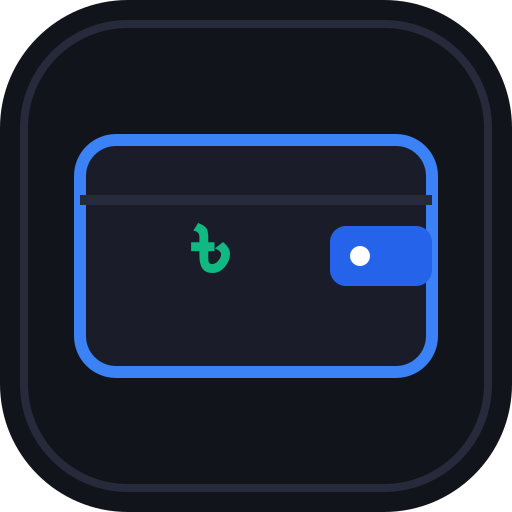

# Wallet — Personal Expense Tracker (PWA & SQLite)

A modern, phone-first personal expense tracker designed specifically for Android displays. Powered by an in-browser **SQLite (WASM)** database with **UUID-based sync architecture** for future cross-device local network synchronization.



---

## 🌟 Key Features

- **📱 Mobile-First Thumb Zone UX**:
  - Fullscreen Standalone Progressive Web App (PWA) with zero browser address bar clutter.
  - Native feel with bottom navigation, rapid quick-add bottom sheet, and large touch targets.
  - OLED Dark Mode theme optimized for mobile battery life and high contrast.
  - Safe-area inset support for Android gesture pills and camera punch-holes.

- **💾 Real In-Browser SQLite Engine**:
  - Powered by WebAssembly (`sql.js`) with debounced IndexedDB binary persistence.
  - 100% client-side: Zero cloud accounts, zero tracking, zero remote database.
  - Works completely offline after initial load.
  - One-click native **`.sqlite` database download/restore**.

- **🔄 Future Cross-Device Sync Ready**:
  - Every transaction is assigned a **UUID v4** primary key.
  - Distributed **Last-Write-Wins (LWW)** metadata (`created_at`, `updated_at`, `deleted_at` tombstones, and `device_id`).
  - Export and merge sync packages between phone and desktop over local network without duplicate records or lost deletions.

- **📊 Comprehensive Financial Ledger**:
  - Net Balance, Monthly and All-Time totals.
  - Account split: **Bank / MFS Account** vs. **Cash**.
  - **Account Reconciliation / "Need Balancing"** sanity indicator.
  - Expense categories with visual spending breakdown progress bars.
  - Full CSV export compatible with Excel and Google Sheets.

---

## 🚀 Running Locally (with Bun)

```bash
# 1. Install dependencies
bun install

# 2. Start the local development server
bun dev

# 3. Build for production (GitHub Pages)
bun run build
```

---

## 📱 How to Use on Your Android Phone

1. Deploy to GitHub Pages (or run on local network).
2. Open the URL in **Google Chrome** on your Android phone.
3. Tap the browser menu (**⋮**) and select **"Add to Home screen"** or **"Install app"**.
4. The app will launch in standalone fullscreen mode just like a native Android app, with its own icon and splash screen.

---

## 🚀 Deploying to GitHub Pages

1. Push this repository to GitHub:
   ```bash
   git add .
   git commit -m "Initial Wallet app with in-browser SQLite and mobile PWA"
   git remote add origin https://github.com/<your-username>/wallet.git
   git push -u origin master
   ```
2. In your GitHub repository:
   - Go to **Settings** > **Pages**.
   - Under **Build and deployment** > **Source**, select **GitHub Actions**.
3. The `.github/workflows/deploy.yml` workflow will automatically build and publish your app at `https://<your-username>.github.io/wallet/`.
